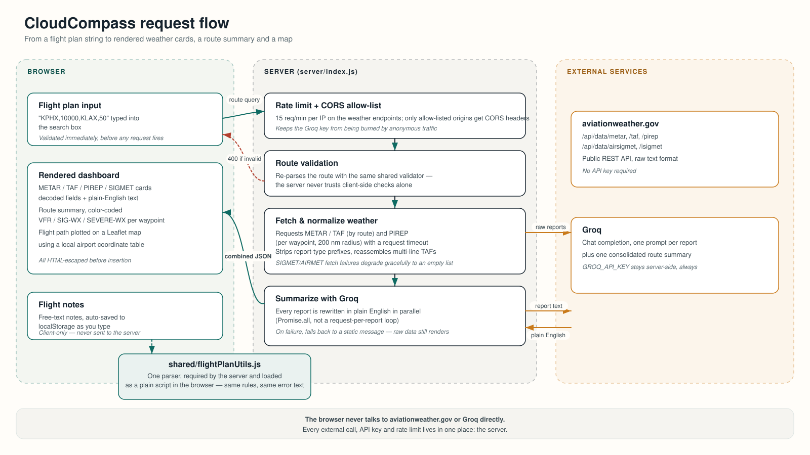

# CloudCompass

[](https://github.com/chxmq/cloudcompass/actions/workflows/ci.yml)
[](LICENSE)

Aviation weather dashboard for flight planning. Enter a route as a list of airport codes and altitudes, and CloudCompass pulls METAR, TAF, PIREP and SIGMET data for it, decodes the raw reports, rewrites each one in plain English, and plots the route on a map.

## Architecture



The browser and the server both validate a flight plan with the same code (`shared/flightPlanUtils.js`) so client-side and server-side errors never disagree. The server is the only thing that talks to `aviationweather.gov` or Groq — the browser never sees an API key or makes an external request directly. Every weather-fetching endpoint is rate-limited per IP and restricted to allow-listed origins.

## Features

- METAR, TAF, PIREP and SIGMET data for every airport in a route
- Each report decoded into structured fields, plus a plain-English rewrite via Groq
- Route-level summary: overall conditions, key hazards, altitude range
- Per-waypoint VFR / significant-weather / severe-weather classification
- Flight path and waypoints plotted on a Leaflet map
- Read-aloud route summary (Web Speech API)
- Flight notes, auto-saved to `localStorage`, never sent to the server
- Google Translate integration for the rendered UI

## Project structure

```
cloudcompass/
├── public/                  # Static client, served as-is
│   ├── index.html
│   ├── script.js
│   └── styles.css
├── server/
│   └── index.js             # Express app: routes, rate limiting, Groq/aviationweather.gov calls
├── shared/
│   └── flightPlanUtils.js   # Flight plan parsing/validation, used by both server and browser
├── test/
│   └── flightPlanUtils.test.js
├── docs/
│   └── architecture.svg
├── .github/
│   ├── workflows/ci.yml     # Tests + Docker build check on every push/PR
│   └── dependabot.yml
├── Dockerfile
├── .env.example
└── package.json
```

## Getting started

### Prerequisites

- Node.js 18+
- A [Groq](https://console.groq.com) API key

### Setup

```bash
git clone https://github.com/chxmq/cloudcompass.git
cd cloudcompass
npm install
cp .env.example .env   # then fill in GROQ_API_KEY
npm start
```

The app is served at `http://localhost:3000`. `npm run dev` runs it under `nodemon` for auto-restart during development.

### Tests

```bash
npm test
```

Runs the flight-plan parsing/validation suite with Node's built-in test runner.

### Docker

```bash
docker build -t cloudcompass .
docker run -p 3000:3000 -e GROQ_API_KEY=your_groq_api_key cloudcompass
```

## CI

[`.github/workflows/ci.yml`](.github/workflows/ci.yml) runs on every push and PR to `main`:

- Unit tests on Node 18, 20 and 22
- `npm audit` at high severity
- A boot smoke test (starts the server, hits `/`, `/api/config`, `/script.js`, `/flightPlanUtils.js`)
- A Docker build check (image is built but not published)

## Configuration

Set these in `.env` (see `.env.example`):

| Variable | Required | Default | Purpose |
|---|---|---|---|
| `GROQ_API_KEY` | Yes | — | Used to generate plain-English weather summaries |
| `PORT` | No | `3000` | Port the server listens on |
| `ALLOWED_ORIGINS` | No | `http://localhost:3000,http://127.0.0.1:3000` | Comma-separated origins allowed to call the API cross-origin. Same-origin requests always work regardless of this value |

## API

| Endpoint | Method | Query params | Returns |
|---|---|---|---|
| `/api/weather` | GET | `route` — e.g. `KPHX,10000,KLAX,50` | Raw + decoded METAR/TAF/PIREP/SIGMET, plus a plain-English summary per report |
| `/api/consolidated-summary` | GET | `route` | One Groq-generated summary covering the whole route |
| `/api/config` | GET | — | Map center/zoom defaults for the client |

`route` is a comma-separated list of alternating airport code (3-4 uppercase letters) and altitude in feet (0-60000). Both weather endpoints are rate-limited to 15 requests/minute per IP.

## Usage

1. Enter a flight plan, e.g. `KPHX,1500,KBXK,12000,KPSP,20000,KLAX,50`
2. Click **Get Weather**
3. Read the decoded reports, the route summary, and the flight path on the map
4. Optionally translate the page or open the notes panel to jot down flight planning notes

## License

MIT — see [LICENSE](LICENSE).
